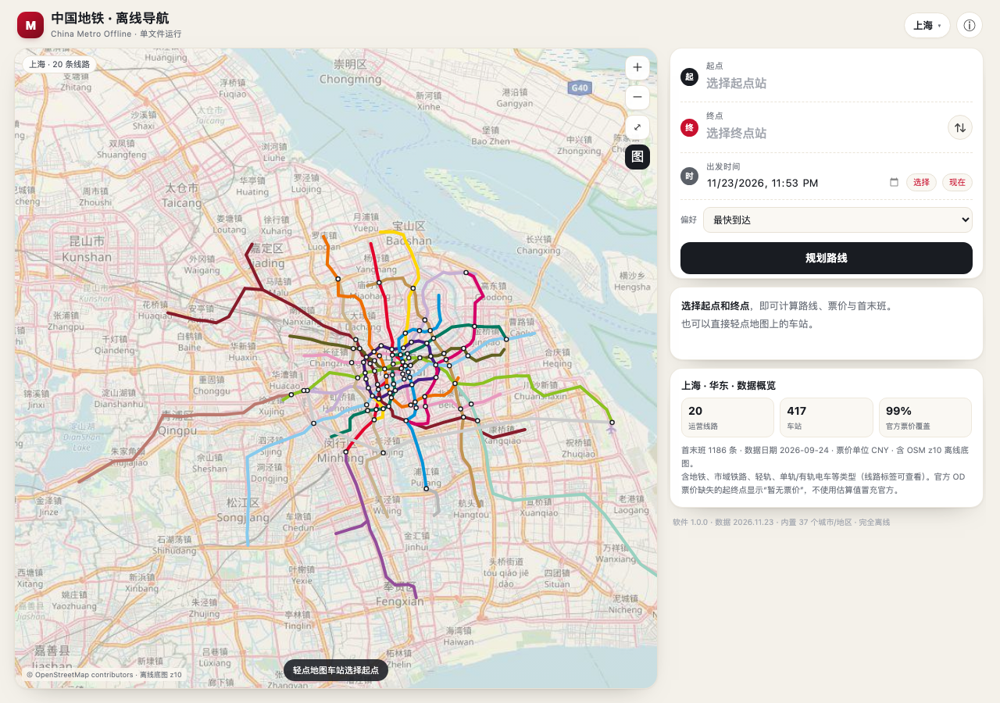
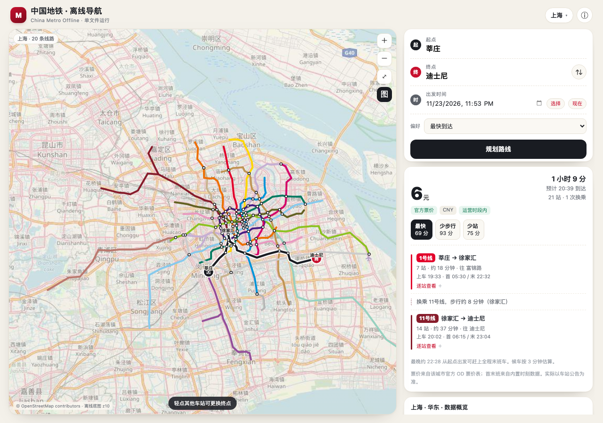
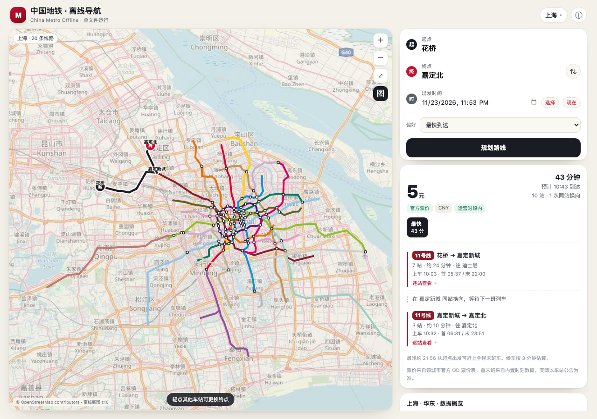

# 模块显示测试报告

测试日期：2026-11-23  
测试文件：`ChinaMetro.html`  
测试方式：Playwright + Chromium 151，`file://`，1280×900 桌面 / 390×844 手机。

## 结果

**17 / 17 项显示检查通过，0 个页面错误。**

| # | 模块/场景 | 截图 | 检查点 |
|---|---|---|---|
| 01 | 首页 · 上海 | `display/01-home-shanghai.png` | 城市名、20 条线路、417 站、OSM z10 底图、数据概览 |
| 02 | 城市选择 | `display/02-city-sheet.png` | 37 个城市/地区、搜索框、未收录城市提示 |
| 03 | 站点搜索 | `display/03-station-search.png` | “迪士尼”命中、线路标签、选择状态 |
| 04 | 上海路线 | `display/04-route-shanghai.png` | 6 元、69 分钟、1 次换乘、逐站、首末班、路线高亮 |
| 05 | 支线换向 | `display/05-branch-direction-change.png` | 花桥→嘉定北，在嘉定新城同站换向，不再显示 0 次换乘 |
| 06 | 末班车 | `display/06-late-warning.png` | 23:59 出发，提示 1 号线末班已过 |
| 07 | 北京路线 | `display/07-route-beijing.png` | 西直门→国贸、4 元、30 分钟、1 次换乘；含北京 OSM z10 底图 |
| 08 | 数据说明 | `display/08-data-info.png` | 37 城市、339 线、6464 站、未收录城市、来源与限制 |
| 09 | 底图开关 | `display/09-tiles-off.png` | 关闭后线路/站点仍可读，按钮状态同步 |
| 10 | 移动端 | `display/10-mobile.png` | 地图、起终点、时间、票价、路线卡均正常 |
| 11 | 非上海深度缩放/拖动 | `display/11-non-shanghai-zoom.png` | 北京 8× 放大并拖到边界，底图仍覆盖视口，无十字白条 |
| 12 | 少许放大 + 拖动 | `display/12-small-zoom-drag.png` | 北京 1.3× 放大并拖动，线路与底图均正常，无中心空白 |
| 13 | 运营时间外 | `display/13-out-of-hours.png` | 01:00 搜索：徽章有文字（首班前/首班 05:30），无空白框 |
| 14 | 点击选择时间 | `display/14-time-picker.png` | 点“选择”打开 24 小时 + 5 分钟面板；选 12:30 后写回原生输入并重算 |

## 说明

- 37 城均内置 **OSM z10 底图**：771 张源瓦片拼成 37 张城市图，已内嵌并保留署名。
- 放大时的中心十字空白（线路消失、底图正常，上海也受影响）已通过“线路层屏幕坐标直接重绘 + 单城市拼接图 + 视口夹取”修复。
- 上海沿用已校验的 z10 瓦片；其余城市由 `tile.openstreetmap.de` 获取后本地转 JPEG。OSM 主站对批量请求返回 403，未使用主站错误图。
- z10 是城市级背景，放大后会模糊；没有 z11+ 街道级细节。
- 测试截图中的北京/天津等城市底图均已显示。
