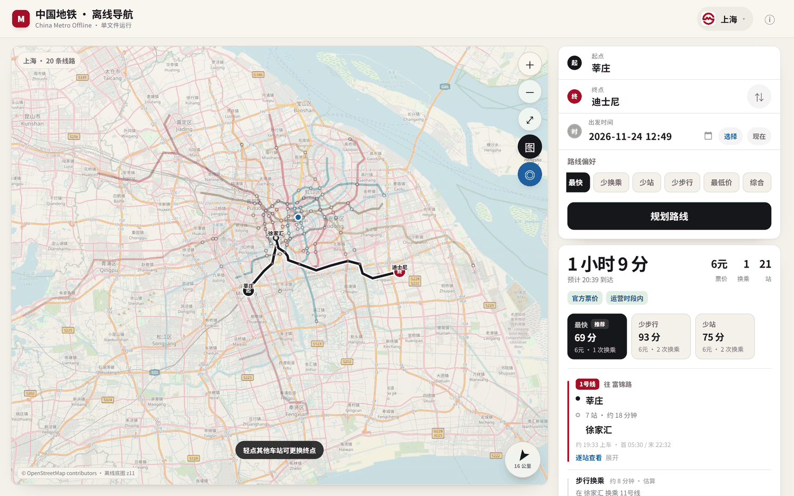
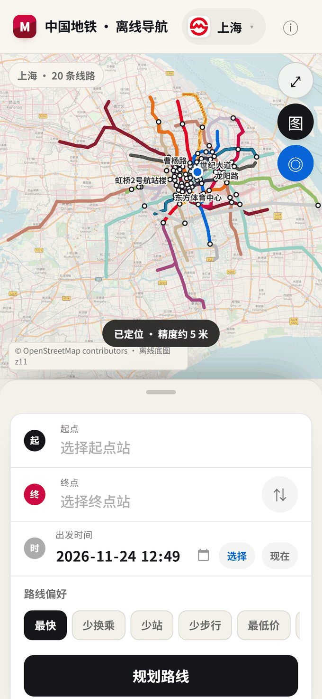
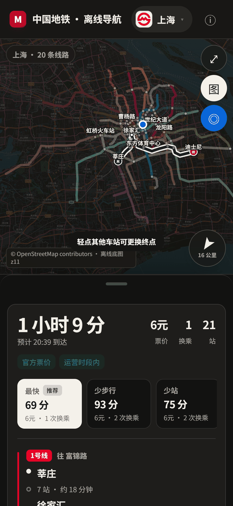

# China Metro Offline · 中国地铁离线导航

**在线访问：**
- 全国版：https://ghost888.github.io/ChinaMetro/
- 上海专项版：https://ghost888.github.io/ChinaMetro/shanghai/

**GitHub 仓库：** https://github.com/Ghost888/ChinaMetro

两个项目共用同一个 GitHub Pages 站点，首页均有醒目的“打开即用”入口。

**一个 HTML 文件，就是一套中国城市地铁离线导航系统。**

> 覆盖说明：当前版本内置 **37 个城市/地区**的完整可核实数据，不是“所有中国大陆城市”。未收录城市不生成占位线路、不伪造站点/时刻/票价；后续可按 `DATA_SOURCES.md` 的流程继续扩展。

`ChinaMetro.html` 把页面、CSS、JavaScript、全国城市线路、站点、票价、首末班时刻和路线算法全部内置。双击即可打开，不依赖网络、CDN、外部 JSON、后端服务或任何安装步骤。

| 桌面端 | 移动端（半屏面板） |
|---|---|
|  |  |

## 核心特性

- **真正单文件**：`ChinaMetro.html` 约 23.1 MB，包含 37 个城市/地区、339 条线路、6,464 个车站、7,572 个 Stop、14,789 条首末班记录、37 个城市官方标识，以及 37 张 OSM 离线底图（1,271 张瓦片，按城市范围取 z10–z15）。
- **完全离线**：没有任何 `fetch`、`XMLHttpRequest`、WebSocket、外部脚本/样式/字体/图片；直接 `file://` 打开可用。上海 OSM 瓦片也已内嵌。
- **城市切换**：内置城市搜索、拼音/英文搜索、热门城市列表。
- **路线规划**：最快、少换乘、少站、少步行、最低票价、综合推荐六种偏好。
- **支线正确建模**：区分“同一条线的直通服务”和“需要在交汇站换向”，例如：
  - 上海 11 号线 花桥 → 嘉定北：在嘉定新城同站换向；
  - 上海 5 号线 闵行开发区 → 奉贤新城：在东川路同站换向；
  - 上海 10 号线 航中路 → 虹桥火车站：在龙溪路同站换向；
  - 上海 11 号线 花桥 → 迪士尼：直通，不误拆。
- **官方 OD 票价**：使用各城市官方路径规划器的票价矩阵（1,621,354 个有效 OD 票价），不把上海票价规则套用到全国；缺失时显示“暂无票价”，不做假。
- **首末班 + 末班车校验**：按“车站 + 方向 + 终点”读取首末班，检查每一段换乘是否赶得上末班；区分“运营时段内 / 首班前 / 末班已过”。
- **鼠标友好的时间选择**：保留原生日期时间输入，旁边增加“选择”按钮；点开可用 24 小时 + 5 分钟步进的按钮面板选时间，也可点“现在”。
- **逐站导航**：每段显示线路、方向、上车站、下车站、乘坐站数、上车时刻、首末班、逐站列表。
- **全国离线 OSM 底图**：37 个城市/地区均内置 OSM 底图（1,271 张瓦片拼成 37 张城市图），zoom 按城市范围自动选择：大城市 z11–z12，小城市 z13，澳门 z15 街道级；底图与车站坐标统一为 WGS-84，站名与街道严丝合缝；可开关，不请求在线瓦片。
- **我的位置**：已授权时启动即自动定位（无需点按），地图上显示蓝点与精度圈；未授权时点「◎」或选定起点会触发一次授权请求。若你不在当前城市范围，会提示最近的已收录城市并可一键切换。
- **城市官方标识**：城市按钮与城市列表左侧显示各城市地铁系统的官方 logo（37 城全部内嵌，离线可用）。
- **指向起点**：选定起点后地图右下角出现罗盘按钮（实时距离 + 指针）；点开是全屏指向界面——绿色渐变、大箭头、距离与「右前方」等方位文案，有设备罗盘时按朝向旋转，没有则按北向朝上。
- **移动优先**：手机竖屏、横屏、平板和桌面布局；无外部字体、图标依赖。
- **三段式底部面板**：收起（96 px）/ 半屏 / 展开三档吸附，拖动抓手切换；地图可视区随面板实时调整并重新贴合城市，保证地图始终有合理面积。
- **结果卡先结论后细节**：顶部摘要给出总耗时、预计到达、票价、换乘次数、站数；方案卡片带「推荐」标识；每段显示线路、方向、上/下车站、站数与首末班，步行换乘以虚线轨单独区分。
- **地图降噪**：选中路线时其余线路降透明度到 38%，起点/终点/换乘站统一视觉规范；底图瓦片保持低对比度，路线与站名优先。
- **界面按 Apple HIG 重构**：语义化颜色/字号/间距/圆角令牌、inset-grouped 卡片、半模态面板、44 pt 以上触控目标、分段控件、加载反馈、`prefers-reduced-motion` 与 `prefers-contrast` 适配。
- **深色模式**：跟随系统外观，卡片/面板/文字自动适配，离线底图反相降饱和后仍可辨读。
- **可嵌入**：不读取父页面变量、不修改父页面样式；可在 iframe / WebView 中运行。

深色模式（跟随系统外观）：



各模块显示测试的 14 张截图在 `display/`，逐项说明见 [DISPLAY_TESTS.md](DISPLAY_TESTS.md)。

## 界面结构

- **地图层**：全屏离线底图 + 线路/站点/路线叠层。选中路线时其余线路降到 38% 透明度；起点、终点、换乘站分别用统一的大圆点、白底描边小圆点表示；拖动/缩放/定位/底图开关完整保留。
- **底部面板（移动端）**：三档吸附——收起（96 px，只有抓手）/ 半屏 / 展开。拖动抓手切换，点击抓手在收起与半屏之间切换；面板高度变化时地图重新贴合当前城市。
- **结果卡**：摘要（耗时、到达时间、票价、换乘、站数）→ 方案卡片（横向滚动，首个可行方案标「推荐」）→ 分段详情（线路、方向、上/下车站、站数、首末班）→ 估算与数据来源说明。
- **控件**：六种路线偏好为可横向滚动的分段控件；主操作为深色填充按钮，规划时显示加载态；所有主要控件触控区 ≥ 44 pt。

## 快速开始

1. 下载 `ChinaMetro.html`。
2. 双击用 Chrome / Edge / Safari 打开。
3. 选择城市、起点、终点，点击“规划路线”。

发布到 GitHub Pages：仓库已在 Settings → Pages 中选择从 `main` 分支根目录发布；推送后自动更新，根目录 `index.html` 会跳转到 `ChinaMetro.html`。

无需服务器。若浏览器限制 `file://` 的某些能力，可选用本地静态服务器（可选，不是运行前提）：

```bash
python3 -m http.server 8000
# 打开 http://localhost:8000/ChinaMetro.html
```

## 当前覆盖范围

已收录 **37 个城市/地区**：

北京、长春、长沙、成都、重庆、大连、福州、广州、贵阳、杭州、哈尔滨、合肥、呼和浩特、香港、济南、昆明、兰州、澳门、南昌、南京、南宁、宁波、青岛、上海、沈阳、深圳、石家庄、苏州、太原、天津、乌鲁木齐、武汉、无锡、厦门、西安、徐州、郑州。

> 准确的 37 个网络 ID、城市数和每城数据日期见 `DATA_SOURCES.md`。

**尚未收录**：常州、东莞、佛山、绍兴、嘉兴、金华、洛阳、南通、芜湖、台州、泉州、三亚、温州等。  
本项目在补到可核实的官方数据前**不填充占位线路、不伪造站点、不编造时刻和票价**。因此当前版本不是“所有中国城市都已覆盖”，而是“37 个已核实网络的完整离线版本”。

## 数据与算法

### 数据模型

采用 `Station / Stop / Pattern` 三层拓扑：

- **Station**：物理车站。
- **Stop**：某车站在某条线路上的停靠点。
- **Pattern**：线路交路（主线、支线、环线），决定几何关系。

每个城市还包含：

- `segments`：区间运行时间、距离；
- `transfers`：有向换乘步行边；
- `timetables`：车站 + 线路 + 终点方向的首末班（7 天数组）；
- `fares`：官方 OD 票价矩阵；
- `quality`：线路、车站、票价覆盖率与数据日期。

### 路线

- 图节点为 Stop；区间为 ride 边，换乘为 transfer 边。
- 默认按 **时间** 作为权重；另提供换乘数、站数、步行时间权重。
- 支线拆分：
  - 先检查该站是否有“能直达终点”的官方服务；
  - 有直通服务则不拆；
  - 没有直通服务，按 Pattern 找到交汇点，拆成两段，并插入“同站换向”边；
  - 修正后的上海 11/5/10 号线支线案例已纳入自动化测试。
- 环线使用 Pattern 和双向边，不会死循环；所有网络已做结构校验，无孤立段、无非法端点。

### 票价

- 优先读取官方 OD 票价矩阵，按出发站/到达站直接查表。
- 不同城市独立，不共用上海规则。
- 票价缺失时显示“暂无票价”，不估算。
- 票价矩阵是抓取时点的官方价格，不代表未来政策；城市卡显示数据日期和覆盖率。

### 首末班

- 首末班为“车站 + 线路 + 终点站”粒度。
- 支持 1 天/7 天数组；按出发日期取对应星期。
- 路线模拟逐段检查：
  - 是否在首班前（等待首班）；
  - 是否超过末班；
  - 换乘后是否还能接上下一段；
  - 赶不上时给出具体线路、车站和末班时间。
- 候车时间在缺少完整时刻表时按 3 分钟估算，界面会注明。

## 项目结构

```text
china-metro-offline/
├── ChinaMetro.html          # 最终单文件程序（唯一运行必需文件）
├── index.html               # GitHub Pages 入口（跳转到 ChinaMetro.html）
├── china_db_base.json       # 原始数据快照（若干工具的输入）
├── china_db.json            # 构建用全国数据源（含底图与坐标；体积大，未入库，按需生成）
├── app_template.html        # 应用模板（含 UI/样式/算法/内嵌标识与底图占位）
├── tools/
│   ├── build.py             # 将 china_db.json 注入模板，生成 ChinaMetro.html
│   ├── validate.py          # 数据完整性校验
│   ├── upgrade_tiles.py     # 按城市跨度抓取/拼接 OSM 底图（z10–z15）
│   ├── fix_coord_datum.py   # 车站坐标 GCJ-02 → WGS-84
│   ├── embed_logos.py       # 把 assets/logos/ 下的官方标识内嵌进模板
│   ├── attach_city_tiles.py # 只给单个城市补更高 zoom 的底图
│   └── test_app.mjs         # Playwright 自动化测试
├── assets/
│   ├── logos/               # 37 城官方标识（PNG + 来源清单 index.json）
│   └── screenshot-*.png     # README 截图
├── DATA_SOURCES.md
├── TEST_REPORT.md
├── CHANGELOG.md
├── NOTICE.md
├── AUDIT.md
└── README.md
```

## 构建与测试

```bash
# 1) 生成 ChinaMetro.html（把数据库注入模板）
python3 tools/build.py

# 2) 结构校验：城市/线路/站点/区间/换乘/时刻/票价/连通性
python3 tools/validate.py

# 3) 自动化测试（需要开发环境中的 Playwright；运行时不依赖）
node tools/test_app.mjs
```

可选的维护脚本（都在 `tools/` 下，非运行必需）：

```bash
python3 tools/fix_coord_datum.py               # 车站坐标 GCJ-02 → WGS-84（幂等）
python3 tools/upgrade_tiles.py --max-mp 4      # 重新抓取/拼接 37 城离线底图
python3 tools/embed_logos.py                   # 重新内嵌 assets/logos/ 下的城市标识
```

测试通过后会生成 `test_results.json`，并更新/参照 `TEST_REPORT.md`。

## 已知限制

- **不是所有中国城市**：当前 37 个网络。缺失城市见上；没有用假数据填充。
- **没有完整列车时刻表**：只有首末班 + 方向/终点；候车按 3 分钟估算，到站时间为估算。
- **票价是抓取时点的官方 OD 表**：不包含未来调价、儿童票、特殊人群优惠、月度累计等政策计算。
- **区间运行时间**：部分城市官方逐段时间不可靠，构建时用“官方值 / 线路长度与制式速度”取较保守值；仍可能有几分钟误差。
- **临时停运、临客、故障、节假日特殊图**未接入。
- 地图：底图 zoom 按城市范围自动选择（大城市 z11–z12，小城市 z13，澳门 z15），城市越大放大后越容易发虚；放大到极限后仍会模糊，未接入在线瓦片。可用 `tools/upgrade_tiles.py --max-mp 8` 再提高单城面积预算，代价是单文件更大。
- 线路图层与底图、站点同处一个世界坐标组，拖动/缩放只改一次 `transform`，线宽按 `1/k` 补偿：既不会出现放大时线路消失，也不会出现拖动时线路不跟随。
- 车站坐标已从 GCJ-02 转为 WGS-84（`tools/fix_coord_datum.py`），与 OSM 底图对齐；转换前的偏移在城市尺度约 300–700 m。
- 移动端面板切换档位时地图会重新贴合当前城市（不是保持原缩放）；拖动或缩放后切换档位会回到适配视野。
- 香港/澳门票价单位分别为 HKD / MOP；部分 OD 票价缺失显示“暂无票价”。

## 数据来源与许可

- 城市拓扑、时刻、票价来自 **Open Metro** 中国城市数据集（`Naptie/openmetro`），其上游来源包括各城市地铁运营方、官方路径规划器、开放交通数据等。
- 本项目的应用代码采用 MIT；Open Metro 代码/数据及其上游数据的授权请见 `DATA_SOURCES.md` 与 `NOTICE` 说明。
- 离线底图 © OpenStreetMap contributors，ODbL 1.0；来源为 OSM 德国镜像与法国镜像，构建后按城市拼成单张图内嵌。
- 37 个城市官方标识来自 Wikimedia Commons 与中英文维基百科（公有领域 / CC BY / CC BY-SA / fair use），逐条来源见 `assets/logos/index.json`；标识为各运营方注册商标，仅作指称性使用。
- 本项目为非官方工具，与各城市地铁运营方无隶属关系。实际票价、运营时刻、临时调整以官方公告为准。

## 版本

- 软件版本：`1.5.0`
- 数据版本：`2026.11.23`
- 数据日期：各城市卡片显示（多数为 2026-09 至 2026-10）
